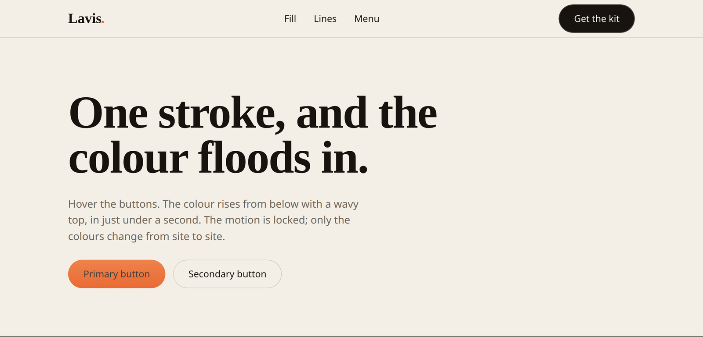
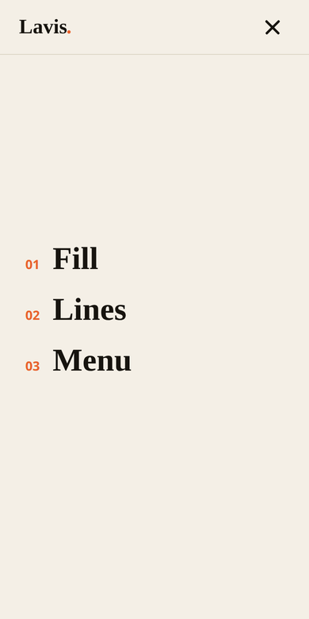

<div align="center">

# Lavis

**A signature kit for websites.** Four locked motions that go on top of an original design and make it recognisable.

[Live demo](https://northcrafto.github.io/lavis/) · [The kit](lavis.md) · [MIT](LICENSE)



</div>

A *lavis* is a wash of diluted ink: one stroke, and the colour floods the paper. This kit does the same to a button.

Lavis is a skill for [Claude Code](https://claude.com/claude-code) and other coding agents that read `SKILL.md` files. It does not design your site. It makes sure every site you build carries the same four details, with the same timing and the same curves, in that site's own colours.

## What is in it

| | |
|---|---|
| **Liquid fill** | Buttons fill from below with a wavy top in about 0.95 s. `.liq` for primary actions, `.liq-ghost` for secondary. |
| **Drawn lines** | Underlines draw in from the left under nav and footer links. `.nav-link`. |
| **The menu** | The hamburger morphs into a cross, a full-screen menu grows as a circle out of the button, and numbered links slide in one at a time. React (Motion) and framework-free versions. |
| **The figures** | Flat hand-drawn people from [unDraw](https://undraw.co), recoloured to the site palette and composed into scenes of their own. |

<div align="center">

</div>

## What it forbids

The rules matter as much as the effects. Each one comes from a real complaint about a real site.

- Nothing tilts or moves when the pointer is over images or cards.
- No scroll-linked animation, and entrances take at most 0.45 s.
- No loops that repaint the page. Loops animate `transform` and `opacity` only.
- No 3D.
- Never the same background in every section.
- No pill badges or tinted bubble labels, no accent-tinted boxes, no gradient avatars, no default-blue controls.
- No AI-generated figures, and the figures stand on the ground.

## Install

```sh
git clone https://github.com/northcrafto/lavis.git ~/.claude/skills/lavis
```

Claude Code picks it up as the skill `lavis` and uses it whenever a site is built or reworked. It works alongside any design skill, or on its own.

Without an agent: copy the CSS from [`lavis.md`](lavis.md), set the five `--sig-*` variables to your palette, and add the classes.

```css
:root {
  --sig-accent: #e8622c;
  --sig-btn: #ffffff;
  --sig-btn-ink: #16161a;
  --sig-fill-top: #2b2b30;
  --sig-fill-bottom: #121214;
}
```

```html
<a class="liq" href="/book">Book a time</a>
<a class="nav-link" href="/about">About</a>
```

## Files

```
SKILL.md      the rules an agent follows on every build
lavis.md      all the code, the forbidden list and the rules for the figures
docs/         the demo page
```

## Credits

Figures by [unDraw](https://undraw.co) (Katerina Limpitsouni). The menu's React version uses [Motion](https://motion.dev).

## License

[MIT](LICENSE) © 2026 northcrafto
